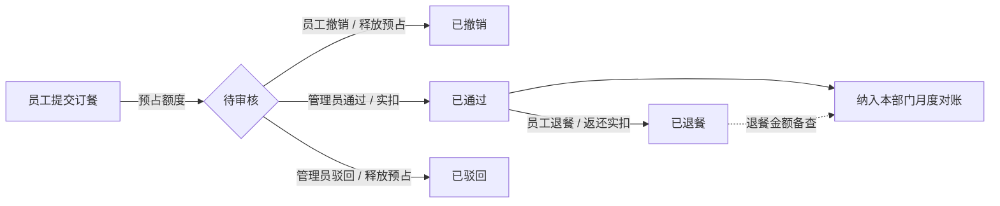
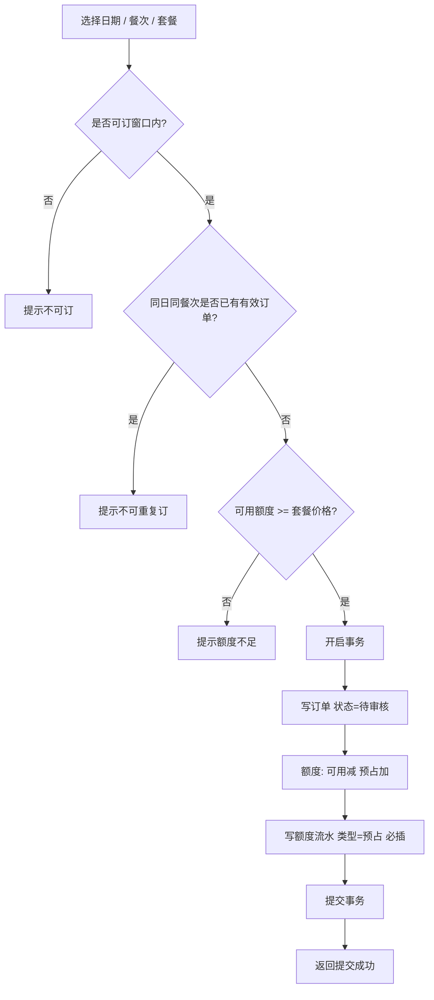
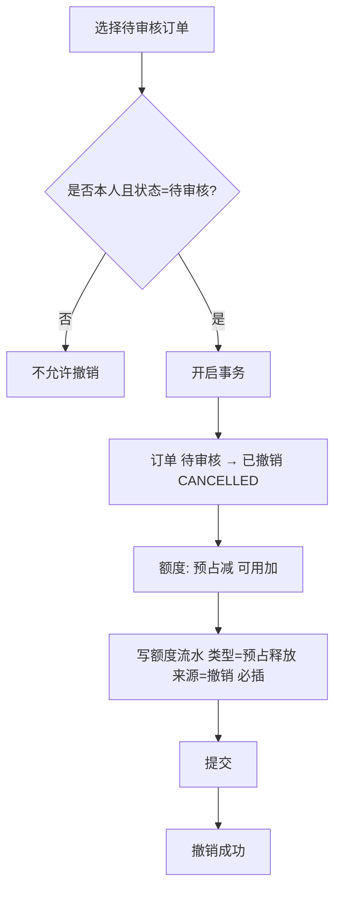
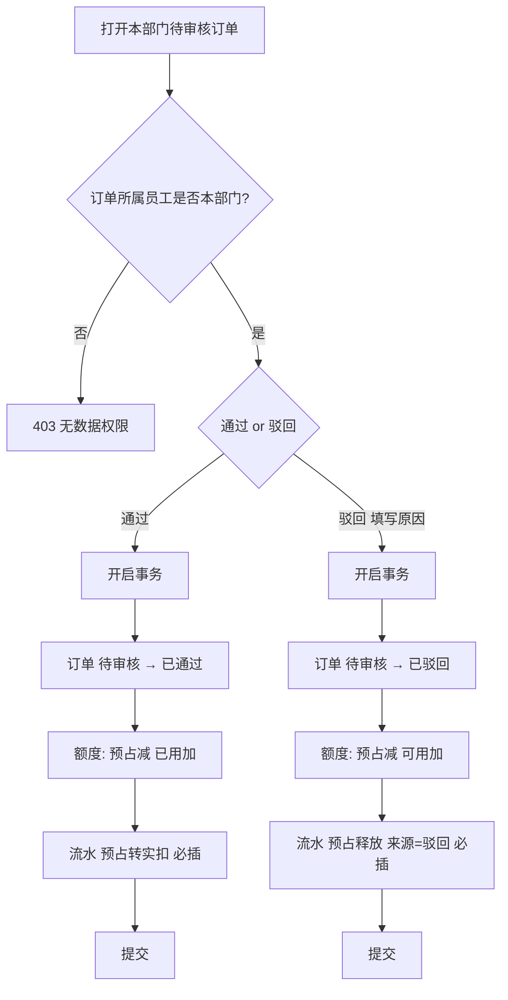
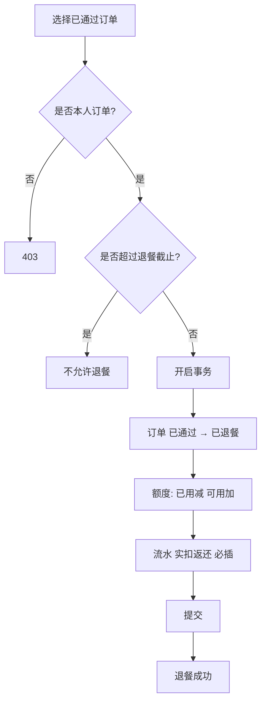
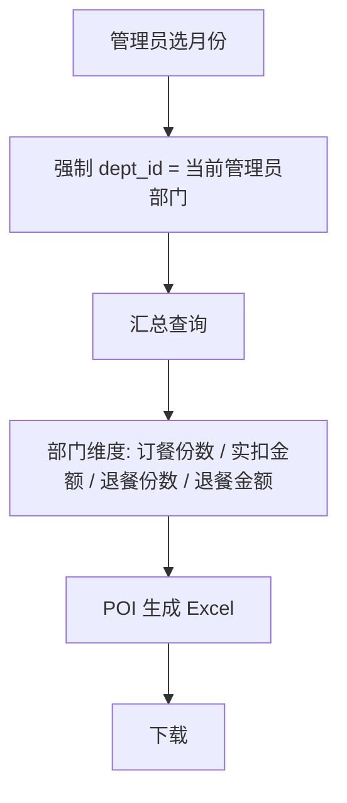

# 企事业单位后勤餐补订餐管理系统 — PRD（精简版）

| 项 | 说明 |
| --- | --- |
| 版本 | V1.1 |
| 日期 | 2026-10-11 |
| 范围 | 第一期：员工订餐/退餐/撤销申请、订单审核、餐补额度、部门月度对账导出 |
| 技术栈 | Spring Boot + MyBatis + MySQL + Redis + JWT + Apache POI |

---

## 1. 业务背景

企事业单位普遍为在岗员工提供工作餐补贴。当前订餐、审核、额度记账、部门对账多依赖纸质单据、微信群或 Excel，数据分散、口径不统一。

本系统面向后勤食堂场景，将「订餐申请 → 审核/撤销 → 额度记账 → 退餐返还 → 部门月度对账」线上化，形成可追溯的餐补台账，支撑后勤管理员日常审核与财务对账。

---

## 2. 业务痛点

| 痛点 | 现状 | 系统要解决什么 |
| --- | --- | --- |
| 订餐无闭环 | 口头/群消息下单，无法核对是否用餐、是否已扣补贴 | 订单状态机：待审核 / 已通过 / 已驳回 / 已撤销 / 已退餐 |
| 额度账不准 | 先扣后审或人工改表，并发下单易超扣、漏扣；改账无痕迹 | 提交预占、审核通过实扣、驳回/撤销/退餐返还；**每次额度变动必记流水** |
| 审核无依据 | 管理员看不到余额、套餐、日期冲突 | 审核工作台展示额度、餐次、申请明细 |
| 对账成本高 | 月末按部门手工汇总，报表慢、易错 | 按部门/月份出对账报表，SQL 优化 + POI 导出 |
| 权限不清 | 员工可改他人数据或看到全单位账单 | JWT + 角色权限 + **数据权限**：员工仅本人，管理员仅本部门 |

---

## 3. 角色说明（含数据权限）

| 角色 | 编码 | 谁 | 功能权限 | 数据权限 |
| --- | --- | --- | --- | --- |
| 普通员工 | `EMPLOYEE` | 在职且有餐补资格的人员 | 登录、查看本人额度、订餐、查看本人订单、待审核撤销申请、已通过订单退餐 | **只能查看/操作本人订单与本人额度**；禁止按员工 ID 越权访问他人数据 |
| 后勤管理员 | `ADMIN` | 本部门后勤管理人员 | 登录、审核本部门订餐、查看本部门订单与额度流水、为本部门员工发放/调整额度、导出**本部门**月度对账报表、维护本部门可见的套餐/餐次（一期建议含基础维护） | **只能查看本部门员工订单与额度**，不是全单位全量；SQL 必须带 `dept_id` 过滤 |

越权访问（员工看他人订单、管理员看其他部门订单）统一返回 403。

说明：一期不做多级审批、不做财务角色、不做「超级管理员看全单位」。管理员即本部门审核人 + 本部门报表导出人。管理员所属部门取用户表 `dept_id`，写入 JWT，查询层强制过滤。

---

## 4. 核心业务规则（已约定）

1. **员工提交订餐申请**：校验餐次可订、未重复订同日同餐次、账户可用额度充足；通过后订单为「待审核」，**预占**对应餐补金额（可用额度减少，已用额度暂不增加）。
2. **管理员审核通过**：仅可审核本部门待审核订单；订单变为「已通过」，预占转为**实扣**（已用额度增加，预占释放）。
3. **管理员审核驳回**：仅可驳回本部门待审核订单；订单变为「已驳回」，**自动释放预占**（可用额度返还）。
4. **员工撤销申请**：仅本人、且订单为「待审核」时可撤销；订单变为「已撤销」（`CANCELLED`）。额度处理**等同驳回**：释放预占，可用额度返还。已通过/已驳回/已退餐不可撤销。
5. **员工退餐**：仅本人「已通过」且在退餐截止时点前可退；订单变为「已退餐」，**自动返还实扣额度**。
6. **并发**：同一员工账户额度扣减/预占/返还必须在数据库事务内完成，防止超扣。
7. **额度流水不可丢失**：账户字段任何一次变动（发放、预占、预占转实扣、预占释放、实扣返还、人工调整）都必须在**同一事务内插入一条额度流水**；流水插入失败则整单回滚。流水用于对账追溯，禁止只改余额不写流水、禁止事后补漏记。
8. **报表**：部门月度对账以「审核通过且未退餐」的实扣金额为准；退餐、驳回、撤销不计入应发/应扣对账（计入流水备查）。管理员只能导出本部门报表。

额度口径：

```
账户总额度 = 可用额度 + 预占额度 + 已用额度
提交成功：可用 ↓，预占 ↑          → 流水：预占
审核通过：预占 ↓，已用 ↑          → 流水：预占转实扣
审核驳回：预占 ↓，可用 ↑          → 流水：预占释放
撤销申请：预占 ↓，可用 ↑          → 流水：预占释放（业务来源=撤销）
退餐成功：已用 ↓，可用 ↑          → 流水：实扣返还
发放/调整：按规则改可用/总额度    → 流水：发放 / 人工调整
```

一期额度来源：管理员按月为本部门员工发放月度餐补；过月是否清零在实现阶段默认「自然月重置，上月剩余不结转」，若需结转再开需求。

---

## 5. 功能清单

### 5.1 公共

- 账号登录 / 退出（JWT，载荷含 `userId`、`role`、`deptId`）
- 角色鉴权（接口级：员工 / 管理员）
- 数据权限拦截（员工 `user_id = 当前用户`；管理员 `dept_id = 当前用户部门`）
- 登录用户信息、修改本人密码
- 全局异常处理 + 统一接口返回

### 5.2 员工端

| 模块 | 功能 | 优先级 |
| --- | --- | --- |
| 额度 | 查看本月总额度、可用、预占、已用 | P0 |
| 菜单/餐次 | 查看可订日期、餐次（早/午/晚，一期可先午晚餐）、套餐及价格 | P0 |
| 订餐 | 选择日期 + 餐次 + 套餐，提交申请 | P0 |
| 订单 | **仅本人**订单列表、状态、金额、审核意见 | P0 |
| 撤销申请 | 对待审核订单撤销，释放预占 | P0 |
| 退餐 | 对已通过订单发起退餐 | P0 |

### 5.3 管理员端

| 模块 | 功能 | 优先级 |
| --- | --- | --- |
| 审核 | **本部门**待审核列表、通过 / 驳回（必填驳回原因） | P0 |
| 订单查询 | 按本部门员工、日期、状态筛选；**不可跨部门** | P0 |
| 额度 | 查看**本部门**员工额度；按月发放 / 调整（每次变动记流水） | P0 |
| 基础数据 | 本部门员工账号；套餐、餐次、退餐截止规则 | P0 |
| 对账报表 | **本部门**月度汇总（人数、份数、实扣金额、退餐份数/金额） | P0 |
| 导出 | POI 导出 Excel（本部门、单月） | P0 |

### 5.4 技术能力（非独立菜单，必须落地）

- 订餐预占、审核实扣、驳回/撤销释放、退餐返还：**同一事务**更新订单状态 + 额度账户 + **强制写入额度流水**
- 报表查询：按月、本部门走汇总 SQL（避免一次性拉全量明细再内存聚合）；必要索引
- Redis：缓存套餐/餐次、登录用户与权限、员工当月额度概要（额度变更主动失效）
- JWT：无 session；请求头鉴权；**角色权限 + 部门数据权限**
- 全局异常处理：业务异常、参数校验、鉴权失败、系统异常统一捕获；接口统一返回 `{ code, message, data }`

### 5.5 明确不做（一期）

- 支付、第三方食堂机、人脸/工卡闸机
- 多食堂、多租户、跨部门管理员、全单位超级管理员
- 营养分析、评价、购物车多份混搭（一期一单一餐次一份）
- 工作流引擎、消息中心（可用站内状态展示，不做推送）

---

## 6. 业务流程图

### 6.1 总览



### 6.2 员工订餐



### 6.3 员工撤销申请



### 6.4 管理员审核（本部门数据权限）



### 6.5 员工退餐



### 6.6 本部门月度对账导出



---

## 7. 订单与额度状态（实现对照）

**订单状态**

| 状态 | 含义 | 额度 | 谁可操作下一跳 | 是否进月报实扣 |
| --- | --- | --- | --- | --- |
| `PENDING` 待审核 | 已申请 | 预占 | 员工可撤销；本部门管理员可通过/驳回 | 否 |
| `APPROVED` 已通过 | 审核通过 | 实扣 | 员工可退餐（截止前） | 是 |
| `REJECTED` 已驳回 | 管理员驳回 | 已释放预占 | 终态 | 否 |
| `CANCELLED` 已撤销 | 员工撤销申请 | 已释放预占（逻辑同驳回） | 终态 | 否 |
| `REFUNDED` 已退餐 | 通过后取消 | 已返还实扣 | 终态 | 否（实扣冲回） |

`REJECTED` 与 `CANCELLED` 额度结果相同（预占释放），必须分状态：驳回是管理员行为，撤销是员工行为，对账追溯口径不同。

**额度流水（强制）**

- 每一次额度账户字段变化 = 必须插入 1 条流水，不允许丢失。
- 流水与账户更新同一事务；禁止「先改余额再异步补流水」。
- 建议字段：流水号、账户 ID、员工 ID、部门 ID、变动类型、变动金额、变动前可用/预占/已用、变动后可用/预占/已用、关联订单号、业务来源（订餐/通过/驳回/撤销/退餐/发放/调整）、操作人、时间。
- 类型枚举：发放、预占、预占转实扣、预占释放、实扣返还、人工调整。预占释放用业务来源区分驳回 vs 撤销。

---

## 8. 非功能要求（紧贴技术点）

| 类别 | 要求 |
| --- | --- |
| 一致性 | 额度账户行级锁或乐观锁 + 事务；余额不足失败整单回滚；**流水与余额同事务必成对** |
| 性能 | 待审核列表、本人订单、月报汇总 P95 可接受（月报走聚合 SQL + 索引，禁止全表扫进应用再 group） |
| 缓存 | 套餐、餐次、部门、当月额度概要走 Redis；写额度后删缓存 |
| 安全 | JWT 过期一期用过期重登；密码加密存储；角色 403；**数据权限在查询/更新 SQL 强制带 user_id 或 dept_id** |
| 导出 | 单次导出限制本部门 + 单月、行数上限，避免内存撑爆 |
| 接口规范 | 统一返回体 `{ code, message, data }`；成功/失败结构一致 |
| 异常处理 | `@RestControllerAdvice` 全局捕获：业务异常（如额度不足、不可撤销）返回明确 `code+message`；参数校验失败；未登录 401；无权限 403；未预期异常不暴露堆栈给前端 |

业务异常示例：额度不足、重复订餐、非待审核不可撤销、非已通过不可退餐、已过退餐截止、跨部门数据访问。

---

## 9. 建议后续开发顺序

1. 库表设计（用户/角色/部门、套餐餐次、订单含 `CANCELLED`、额度账户、额度流水）
2. 统一返回体 + 全局异常处理 + 业务异常类
3. 登录鉴权（JWT + 角色 + 部门数据权限）
4. 额度账户与事务流水（变动必记流水）
5. 订餐 / 撤销申请 / 审核 / 退餐
6. Redis 缓存
7. 本部门月报 SQL 与 POI 导出

下一步建议：确认本 PRD 后进入「数据库表结构设计」，仍不写业务代码。
