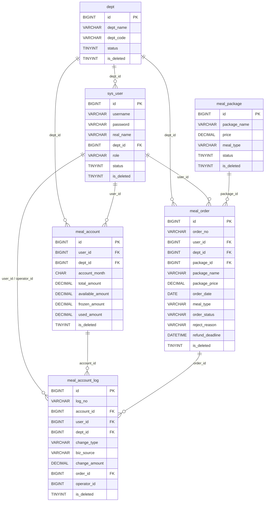

# 数据库设计（对照 PRD V1.1）

- 脚本：`docs/schema.sql`（MySQL 8.0，Navicat 可直接执行）
- 库名：`meal_subsidy`
- 引擎：InnoDB（事务 + 行锁）
- 主键：BIGINT 自增；全表：`is_deleted`

## ER 图

## 设计要点

| 点 | 说明 |
| --- | --- |
| 数据权限 | `sys_user.dept_id`、`meal_order.user_id` / `dept_id` 冗余，查询强制过滤 |
| 行锁 | `meal_account` 一人一月一行，`SELECT ... FOR UPDATE` 锁 `id` 所在行后改余额 |
| 流水 | 账户任何变动同事务插入 `meal_account_log`；`UNFREEZE` 用 `biz_source` 区分驳回 / 撤销 |
| 月报索引 | `meal_order (dept_id, order_date, order_status)` 覆盖「本部门 + 月份区间 + 状态」聚合 |
| 同日同餐次 | 历史终态订单仍保留，唯一性在应用层校验有效订单（`PENDING`/`APPROVED`），不建死唯一索引 |
| 套餐快照 | 订单写入 `package_name`、`package_price`，改套餐不影响历史对账金额 |
| 驳回/退餐 | `reject_reason` 驳回必填；`refund_deadline` 下单时写入，退餐与当前时间比较 |
| 物理外键 | 未建 FOREIGN KEY，避免逻辑删除与并发事务互相阻塞；关联在字段注释中标明 |
